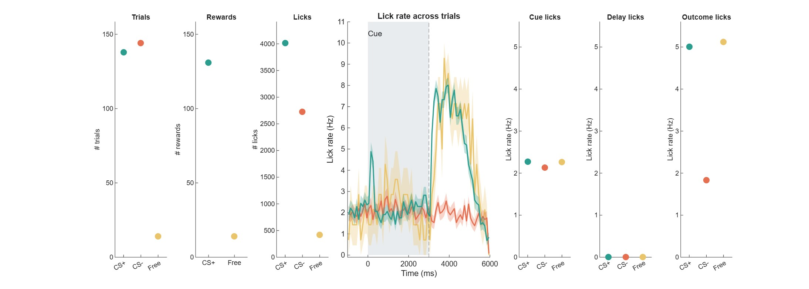

# SPOUT1 example data

Daily session plot of the SPOUT1 example session, made with the analyses scripts. Click a picture to open it at full size.

Back to the [SPOUT1 example data README](../README.md).

<table>
<tr>
<td width="50%" align="center" valign="top"> <code>SPOUT1_example_session.jpg</code> Daily session plot, SPOUT1 example session</td>
<td width="50%"></td>
</tr>
</table>
